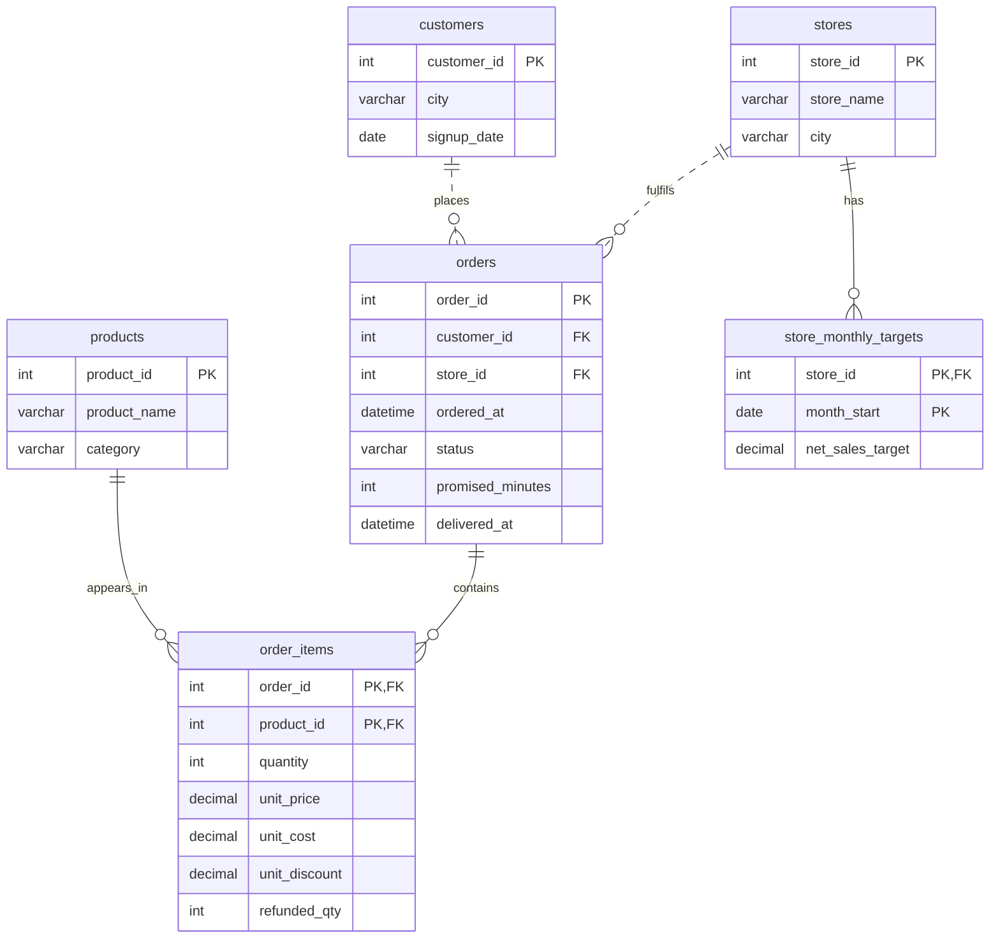

# SwiftBasket | Quick-Commerce Sales Analytics

MySQL case study for a fictional grocery delivery business. Follow **1,500 orders** across **8 dark stores** in four Indian cities from January through June 2025.

## Data model



| CSV | Rows | One row represents |
| --- | ---: | --- |
| [stores](data/stores.csv) | 8 | A fulfilment store |
| [customers](data/customers.csv) | 360 | A customer account |
| [orders](data/orders.csv) | 1,500 | A placed order, delivered or cancelled |
| [order_items](data/order_items.csv) | 5,080 | One SKU in an order |
| [products](data/products.csv) | 31 | A catalogue SKU |
| [store_monthly_targets](data/store_monthly_targets.csv) | 47 | A store's net sales plan for one month |

The [schema](schema.sql) aggregates item amounts to one row per order before counting orders. A recursive CTE builds all 48 store-month combinations so the scorecard also shows stores with zero sales. The sample includes one store-month with zero orders and another with a missing target.

## Query guide

| Queries | Business questions | SQL covered |
| --- | --- | --- |
| [Q01–Q03 · Sales overview](queries/01_sales_overview.sql) | How did sales trend? Which stores beat target? | Aggregation, `GROUP BY`, left joins, `CASE` |
| [Q04–Q06 · Products and baskets](queries/02_product_and_basket.sql) | Which categories led? What sells together? Which listed SKU had zero sales? | Inner, left and self joins, `DISTINCT`, `HAVING`, `LIKE`, `COALESCE` |
| [Q07–Q08 · Subqueries](queries/03_subqueries.sql) | Which baskets beat their store average? Which SKUs stopped selling? | Correlated subquery, `EXISTS`, `NOT EXISTS` |
| [Q09–Q12 · Window functions](queries/04_window_functions.sql) | How did stores grow and rank? How concentrated was customer spend? | `LAG`, `LEAD`, `FIRST_VALUE`, `LAST_VALUE`, `RANK`, `DENSE_RANK`, `ROW_NUMBER`, `NTILE` |
| [Q13–Q15 · CTE case studies](queries/05_cte_case_studies.sql) | Who came back next month? How did discounts relate to margin? What should sales ops investigate? | Chained CTEs, date joins, conditional buckets, ratios, exception flags |
| [Q16–Q17 · Sets and validation](queries/06_sets_and_validation.sql) | Who bought in one or both quarters? Do the data pass integrity checks? | `UNION ALL`, `INTERSECT`, `EXCEPT`, reconciliation |

For CTE practice, start with **Q13**. It reduces delivered orders to one row per customer and month, finds each customer's first observed delivery month, and counts who returned the next month. **Q15** builds a store scorecard, filters it to target exceptions, and assigns a review flag. In both queries, you can inspect a stage by selecting from its CTE.

## KPI snapshot

| KPI | Result | Calculation |
| --- | ---: | --- |
| Net merchandise sales | ₹4,99,650.86 | Delivered item value less discounts and refunds |
| Delivered orders | 1,382 | Orders with status `DELIVERED` |
| Average order value | ₹361.54 | Net merchandise sales ÷ delivered orders |
| Gross margin | 28.09% | Merchandise gross profit ÷ net merchandise sales |
| Cancellation rate | 7.87% | Cancelled orders ÷ placed orders |
| On-time delivery rate | 82.42% | Deliveries within the promised time ÷ delivered orders |

Refunded units reverse the discounted selling price and unit cost. Sales and margin cover merchandise only, with delivery fees, taxes and operating costs outside the calculation.

- **Growth and target gaps.** Net sales rose **47.73%** from January to June, while **25 of 47** store-months with plans missed their targets. Powai's June result was ₹4,102.97 below plan, with 15.15% of placed orders cancelled. [Sales overview](queries/01_sales_overview.sql) · [Store investigation](queries/05_cte_case_studies.sql)
- **Customer concentration.** The highest-spending quartile accounted for **51.50%** of net sales. **60.55%** of the January delivery cohort ordered again in February. [Customer quartiles](queries/04_window_functions.sql) · [Retention](queries/05_cte_case_studies.sql)
- **Discount mix.** Orders discounted above 10% averaged a **20.33% gross margin**, compared with **34.18%** for orders without discounts. Use the comparison to decide where to investigate order mix. [Discount analysis](queries/05_cte_case_studies.sql)

## Run locally

Use MySQL **8.0.31 or later** for `INTERSECT` and `EXCEPT`. From the repository root, create a fresh database and load the checked-in snapshot:

```bash
mysql -u root -p -e 'CREATE DATABASE swiftbasket CHARACTER SET utf8mb4;'
mysql -u root -p swiftbasket < schema.sql
mysql -u root -p swiftbasket < seed.sql
cat queries/*.sql | mysql -u root -p swiftbasket
```

The [seed](seed.sql) contains the same records as the CSVs. Run an individual query file by passing it to the MySQL client. Q17 should return zero rows. To regenerate the CSVs and seed, run `python3 scripts/generate_data.py`.

## Data sources

All records are generated for this project. The public Blinkit sales sample informed the order and product structure, while catalogue and dark-store previews helped identify useful store and SKU fields. Eternal's annual report provided context for sales and order-volume KPIs. [Blinkit sales sample](https://www.kaggle.com/datasets/akxiit/blinkit-sales-dataset) · [QuickCommerceData previews](https://www.quickcommercedata.com/datasets) · [Eternal FY2025 annual report](https://b.zmtcdn.com/investor-relations/Eternal_Annual_Report_2024-25.pdf)
